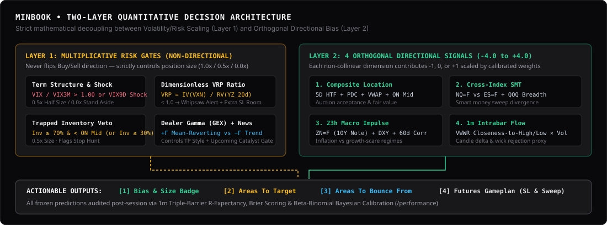
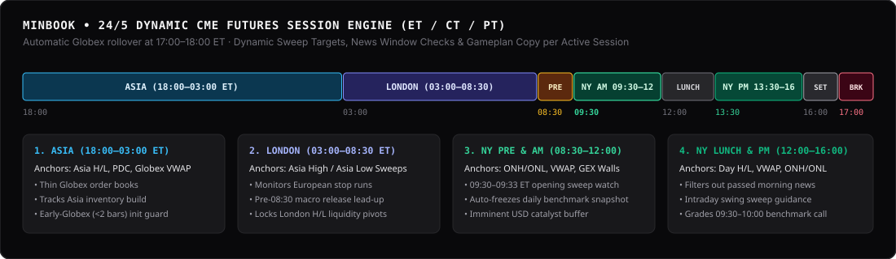
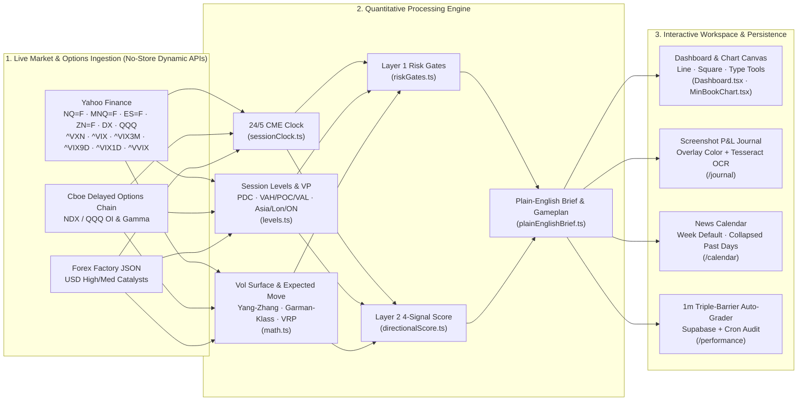
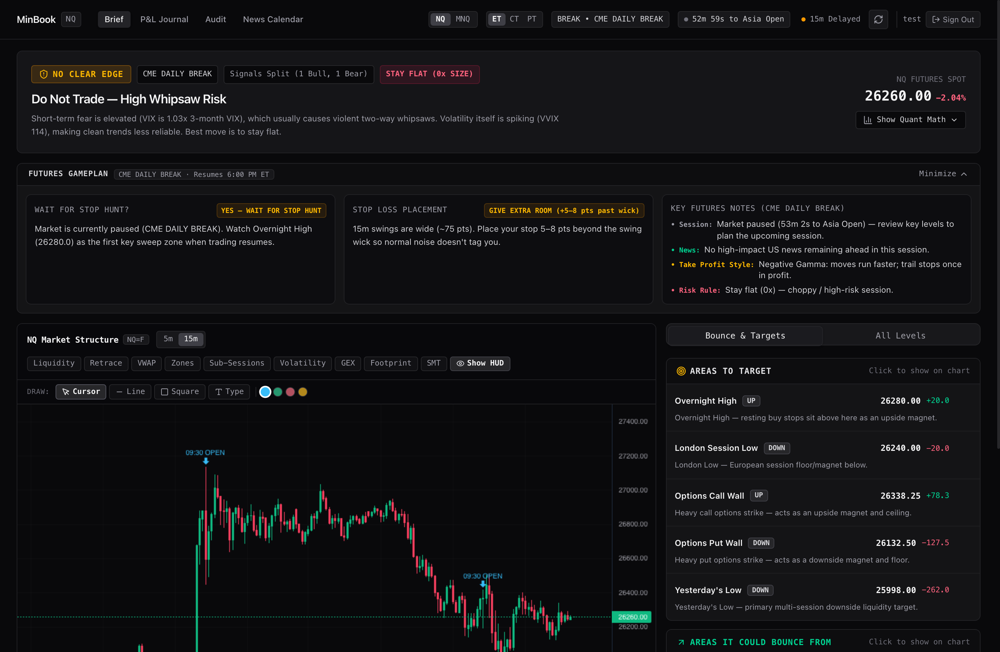
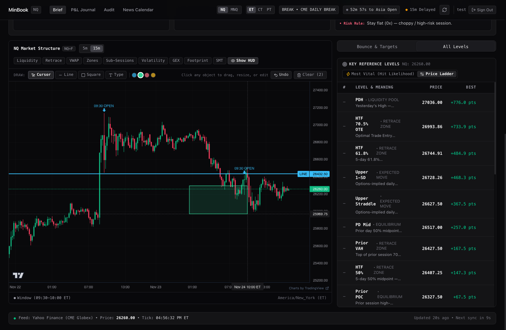
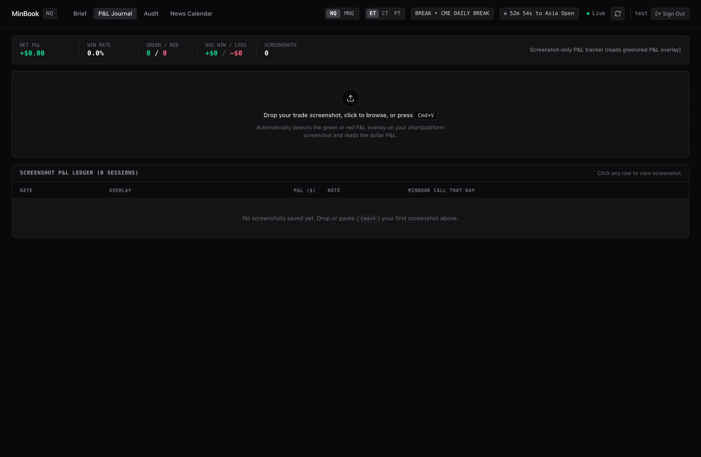
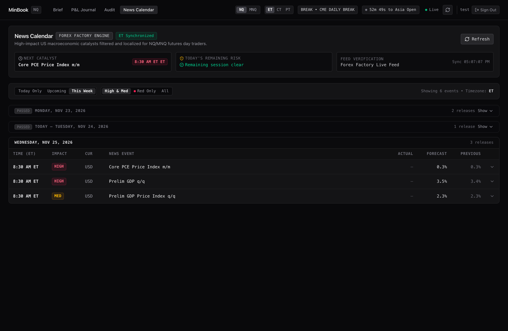
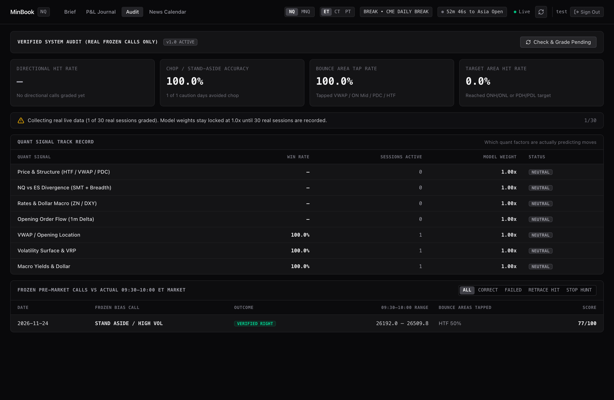
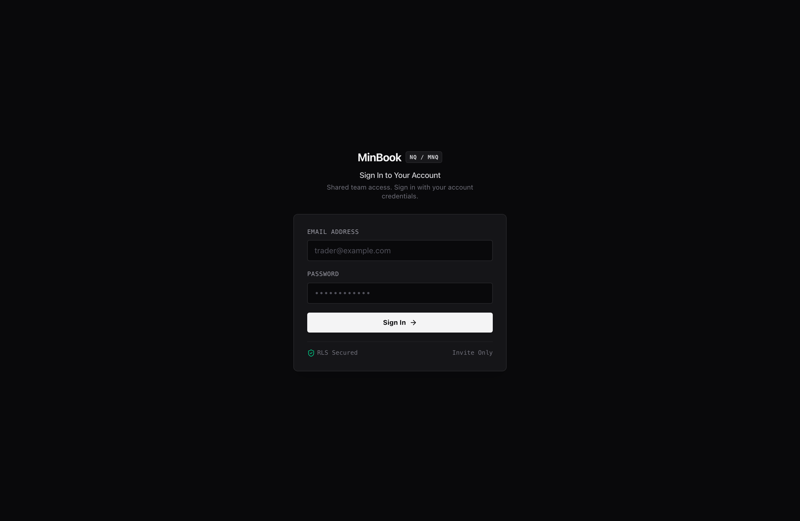
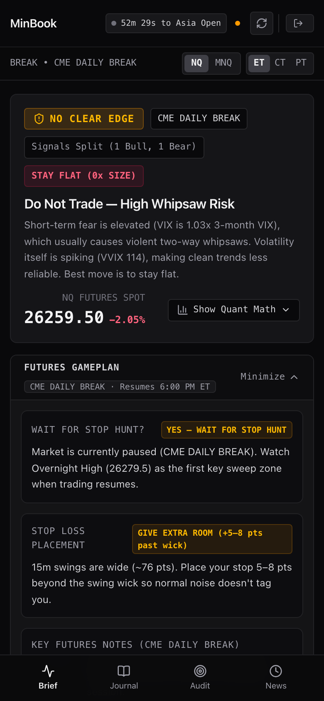

<div align="center">

# MinBook

**24/5 Quantitative Futures Bias, Key Liquidity Levels & Audit Terminal for CME Nasdaq-100 (`NQ` / `MNQ`)**

[](https://nextjs.org/)
[](https://www.typescriptlang.org/)
[](./src/__tests__)
[](https://www.tradingview.com/lightweight-charts/)
[](https://minbook-omega.vercel.app)
[](#license--attributions)

[Live Terminal](https://minbook-omega.vercel.app) · [Quantitative Whitepaper](./docs/MinBook_Quantitative_Architecture_and_Reasoning_Whitepaper.md) · [Methodology Spec](./docs/methodology.md) · [Changelog](./.ai/changelog.md)

</div>

---

## Overview

**MinBook** is an analytical quantitative futures terminal designed for multi-user `NQ` / `MNQ` trading across **Asia**, **London**, and **New York** sessions. Rather than burying traders under conflicting indicators or lagging overlays, MinBook separates **risk sizing** from **directional bias**, translates quant metrics into plain English, ranks actionable **Areas To Target** and **Areas It Could Bounce From**, and verifies its own frozen daily calls in a clean audit pipeline.

### Key Pillars
1. **Plain-English Bias First, Math On Demand**: Displays direct bias (`BULLISH`, `BEARISH`, `NO CLEAR EDGE`), active signal count (`X of 4`), and volatility-scaled sizing (`1.0x`, `0.5x`, `0x`) immediately, with the 7 quantitative proof cards collapsed behind `Show Quant Math`.
2. **24/5 Session-Dynamic Gameplan**: Automatically adapts stop-hunt warnings, stop-loss buffer guidance (`AT THE WICK +2–3 pts` vs. `GIVE EXTRA ROOM +5–8 pts` from intraday 15m ATR + VRP), liquidity sweep anchors, and economic news alerts to the live CME session (`ASIA`, `LONDON`, `NY PRE-MARKET`, `NY AM`, `NY LUNCH`, `NY PM`, `POST-CLOSE`).
3. **Interactive Charting + Custom Object Manipulation**: Built on TradingView Lightweight Charts v5 with `5m` / `15m` candles, optional `Liquidity`, `Retrace`, `VWAP`, `Zones`, `Sub-Sessions`, `Volatility`, `GEX`, `Footprint`, and `SMT` layers, plus persistent manipulable drawing tools (`Line`, `Square`, `Type`).
4. **Screenshot-Only P&L Journal (`/journal`)**: Upload, drop, or `Cmd+V` paste broker/chart screenshots; pixel clustering detects green/red P&L overlays and extracts realized P&L via `Tesseract.js` OCR (with optional Gemini Vision).
5. **Honest Self-Audit & Bayesian Calibration (`/performance`)**: Zero synthetic seed data. Freezes daily snapshots cleanly during pre-market/open (`08:30–10:00 ET`), grades outcomes via 1-minute Triple-Barrier simulation, and keeps model weights locked at `1.0x` until 30 real graded sessions exist.

---

## Architecture & Visual Charts

### Two-Layer Gated Decision Engine

<p align="center">
  
</p>

### 24/5 Dynamic CME Session Engine

<p align="center">
  
</p>

### End-to-End Data & Calibration Pipeline



---

## Live Terminal Screenshots

### Main Trading Workspace (`/`) — Hero Bias, Futures Gameplan, Chart & Target/Bounce Levels
<p align="center">
  
</p>

### Quant Math Breakdown, All Levels Price Ladder & Interactive Chart Drawings (`Line` · `Square` · `Type`)
<p align="center">
  
</p>

### Workspace Views — Journal, News Calendar, System Audit & Mobile

| Screenshot-Only P&L Journal (`/journal`) | Week-Default News Calendar (`/calendar`) |
| :---: | :---: |
|  |  |

| Verified System Audit (`/performance`) | Invite-Only Auth (`/login`) | Responsive Mobile View (`390×844`) |
| :---: | :---: | :---: |
|  |  |  |

<details>
<summary><strong>Interactive Chart Tools & Responsive Breakpoints</strong></summary>

* **Chart Drawing Tools (`src/components/chart/MinBookChart.tsx`, `src/components/chart/primitives.ts`)**:
  * **Line**: `0.25`-tick snapped straight horizontal line with native price-axis tag and editable exact price input.
  * **Square**: Click-drag-release or two-corner placement synced across `5m`/`15m` timeframes and right-hand projection whitespace, with `NW` / `NE` / `SW` / `SE` resize handles.
  * **Type**: Inline canvas text annotation anchored to `(timeSec, price)`; double-click or click `Edit` to modify.
  * **Manipulation**: Select, drag to move, recolor (`CYAN`, `EMERALD`, `ROSE`, `AMBER`), `Undo`, `Clear`, `Delete`/`Backspace` removal, and automatic `localStorage` persistence per instrument (`NQ` / `MNQ`).
* **Responsive Across Screens**: Optimized container (`max-w-[1640px]`), responsive canvas heights (`320px` on mobile to `660px` on `2xl` monitors), touch-accessible copy controls, and a mobile/tablet sub-header (`md:hidden`) exposing `NQ | MNQ` and `ET | CT | PT` toggles.

</details>

---

## Quantitative Methodology & Equations

### 1. Realized Volatility & Dimensionless Variance Risk Premium (`VRP`)
MinBook estimates trailing realized volatility using drift-independent OHLC estimators and compares implied Nasdaq-100 volatility (`^VXN`) against realized movement:

$$
\text{Garman–Klass: } \sigma_{\text{GK}}^2 = \frac{1}{n}\sum_{t=1}^{n} \left[ \frac{1}{2}\left(\ln\frac{H_t}{L_t}\right)^2 - (2\ln 2 - 1)\left(\ln\frac{C_t}{O_t}\right)^2 \right]
$$

$$
\text{VRP Ratio} = \frac{\text{IV}_{\text{VXN}}}{\text{RV}_{\text{YZ, 20d}}}, \qquad \text{Term Ratio} = \frac{\text{VIX}}{\text{VIX3M}}
$$

When $\text{VRP Ratio} < 1.0$ or $\text{VIX}/\text{VIX3M} > 1.0$, Layer 1 scales down risk (`0.5x` or `0.0x`), sets Stop Loss advice to **Extra Room (+5–8 pts past wick)**, and warns of elevated two-way whipsaw risk.

### 2. Implied Daily Expected Move & Coverage
Using Rule-of-16 calendar scaling across 365 days:

$$
\text{EM}_{1\text{SD}} = P_{\text{PDC}} \cdot \frac{\text{IV}_{\text{VXN}}}{100 \sqrt{365}}, \qquad \text{EM}_{\text{Straddle}} = \sqrt{\frac{2}{\pi}} \cdot \text{EM}_{1\text{SD}} \approx 0.7979 \cdot \text{EM}_{1\text{SD}}
$$

### 3. Dealer Gamma Exposure (`GEX`) Regime
From options Open Interest and Black-Scholes Gamma ($\Gamma$):

$$
\text{GEX}_K = (\text{OI}_{\text{call}, K} - \text{OI}_{\text{put}, K}) \cdot \Gamma_K \cdot S^2 \cdot 100 \cdot 0.01
$$

Positive net gamma (`+Γ`) identifies mean-reverting pinned sessions (`Call Wall` / `Put Wall` bounds), while negative net gamma (`-Γ`) flags dealer hedging amplification where breakouts travel farther.

### 4. Empirical Grading & Calibration (`grader.ts`, `optimizer.ts`)
* **1m Triple-Barrier Simulation**: Evaluates frozen directional bias against 1-minute execution bars: upper/lower profit targets (`TP1`/`TP2`), stop invalidation (`SL`), and vertical time barrier (`10:00 ET`), plus two-way whipsaw verification for `STAND ASIDE / HIGH VOL` calls.
* **Strictly Proper Scoring**: Evaluates probability calibration via Brier Score $\frac{1}{N}\sum (p_i - y_i)^2$ and Log Score $-\frac{1}{N}\sum [y_i \ln p_i + (1-y_i)\ln(1-p_i)]$.
* **Beta-Binomial Bayesian Shrinkage Gate**: Factor weights remain strictly locked at `1.0x` until $N \ge 30$ real graded sessions are recorded, with prior regularization ($\alpha_0 = 25, \beta_0 = 25$, weights clamped to $[0.6, 1.5]$).

---

## Academic & Technical References

| Area | Reference | Application in MinBook |
| :--- | :--- | :--- |
| **OHLC Volatility** | Garman, M. B., & Klass, M. J. (1980). *On the Estimation of Security Price Volatilities from Historical Data*. **The Journal of Business**, 53(1), 67–78. | Intraday range-based realized volatility baseline (`math.ts`). |
| **Drift-Independent Vol** | Yang, D., & Zhang, Q. (2000). *Drift-Independent Volatility Estimation Based on High, Low, Open, and Close Prices*. **The Journal of Business**, 73(3), 477–492. | Overnight-jump-adjusted 10d/20d realized volatility (`VRP Ratio`). |
| **Triple-Barrier Grading** | López de Prado, M. (2018). *Advances in Financial Machine Learning* (Ch. 3: Labeling). **Wiley**. | Path-dependent 1-minute SL / TP / time-exit auto-grader (`grader.ts`). |
| **Proper Scoring Rules** | Brier, G. W. (1950). *Verification of Forecasts Expressed in Terms of Probability*. **Monthly Weather Review**, 78(1), 1–3; Good, I. J. (1952), *Rational Decisions*, **JRSS-B**. | Brier & Log calibration scores on frozen daily predictions. |
| **Bootstrap Inference** | Efron, B., & Tibshirani, R. J. (1993). *An Introduction to the Bootstrap*. **Chapman & Hall**. | Non-parametric upper 90% MAE confidence intervals (`optimizer.ts`). |
| **Options & GEX Mechanics** | Black, F., & Scholes, M. (1973). *The Pricing of Options and Corporate Liabilities*. **Journal of Political Economy**, 81(3); Cboe Volatility Index (`VIX` / `VXN`) Whitepaper. | Dealer gamma (`Gamma Flip`, `Call/Put Wall`), term structure, and Rule-of-16 bands (`gex.ts`, `math.ts`). |
| **Market Profile & Auction** | Steidlmayer, J. P. (1985). *Markets and Market Logic*; Dalton, J. F. et al., *Mind Over Markets*. | Prior-day RTH Value Area (`VAH`, `POC`, `VAL`) & Opening Location archetypes (`levels.ts`, `playbook.ts`). |

---

## Application Routes & Test Suite

### App & API Surface

| Route | Purpose | Data Source / Mode |
| :--- | :--- | :--- |
| `/` | Main decision dashboard (Bias Hero, Futures Gameplan, Chart + Drawing Tools, Target/Bounce Areas, Price Ladder) | Client + `force-dynamic` live polling (`30s`) |
| `/journal` | Screenshot-only P&L journal with green/red overlay pixel clustering & `Tesseract.js` OCR | Supabase Postgres + Storage (or SQLite fallback) |
| `/performance` | Verified audit ledger, signal track record & pending session grader | Immutable frozen calls only (`30`-session gate) |
| `/calendar` | Week-default US economic news calendar with collapsed past days & ET/CT/PT conversion | Forex Factory delayed JSON feed |
| `/settings` | Per-account risk budget, instrument defaults (`NQ`/`MNQ`) & feed status | Supabase `user_settings` (or SQLite) |
| `/login` | Invite-only email/password authentication | Supabase Auth (`@supabase/ssr`) |
| `/api/market-data` | Full quantitative brief, levels, GEX, SMT & 1m flow proxy | `force-dynamic`, `no-store` |
| `/api/market-data/chart` | Intraday `5m` & `15m` OHLCV bars | `force-dynamic`, `no-store` |
| `/api/cron/snapshot-and-grade` | Weekday cron job (`25 14 * * 1-5` UTC via `vercel.json`) to freeze & grade sessions | Protected by `CRON_SECRET` |

### Test Coverage (`17` Test Files · `126` Passing Tests)
```bash
npm test          # Vitest suite (volatility, GEX, SMT, footprint, sessionClock, chart primitives, grader, calibration, OCR)
npx tsc --noEmit  # Strict TypeScript verification
npm run build     # Next.js 16.4 Turbopack production build
```

---

## Local Setup & Deployment

### Prerequisites
* **Node.js `24.x`** (required for native `node:sqlite`)
* **npm**

### Quick Start
```bash
git clone https://github.com/Minsung1Kim/minbook.git
cd minbook
npm install
cp .env.example .env.local
npm test
npm run dev
```

Open [http://localhost:3000](http://localhost:3000).

### Key Environment Variables (`.env.example`)
```bash
# Market Data
MARKET_DATA_PROVIDER=yahoo
CACHE_TTL_SECONDS=10

# Supabase Auth, Postgres & Screenshot Storage
NEXT_PUBLIC_SUPABASE_URL=
NEXT_PUBLIC_SUPABASE_ANON_KEY=
SUPABASE_SERVICE_ROLE_KEY=

# Automated Cron Freeze/Grade Secret (vercel.json)
CRON_SECRET=

# Optional Vision OCR Fallback
GEMINI_API_KEY=
```

---

## License & Attributions

* **Analytical Software Notice**: MinBook is a quantitative market-organization and journaling tool for informational and educational workflows. It does not provide financial advice, trade recommendations, or automated order execution.
* **Market Data Latency**: Unauthenticated web futures feeds (`NQ=F`, `ES=F`) carry exchange-mandated delays (typically 10–15 minutes); MinBook explicitly surfaces quote timestamps and `Live` / `15m Delayed` badges across the header, chart HUD, and status bar.
* **Charting Attribution**: Interactive charts are powered by [TradingView Lightweight Charts™](https://www.tradingview.com/lightweight-charts/), licensed under the **Apache License, Version 2.0**.
* **Repository License**: Licensed under the **MIT License**.
