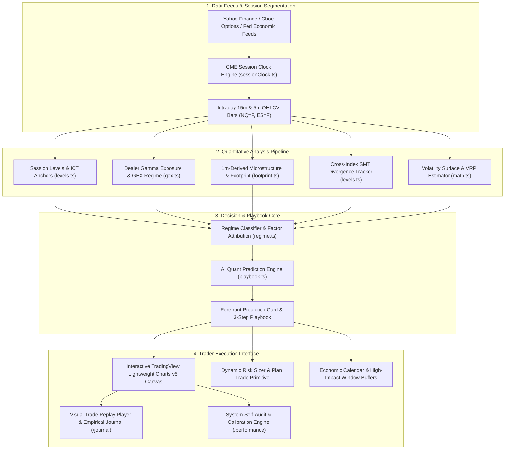

# MinBook

> **Quantitative NY Open Decision Engine for CME Nasdaq-100 Futures (`NQ` / `MNQ`)**

MinBook is an action-first quantitative decision platform engineered specifically for retail and prop futures traders executing **one high-conviction trade per day** during the New York cash open window (9:30 AM – 10:00 AM ET).

Instead of subjective chart drawing or lagging indicators, MinBook synthesizes options-implied volatility surfaces, dealer gamma exposure (GEX), cross-index smart money divergence (SMT), and session order flow imbalances into concrete execution plans.

---

## Architecture & System Overview



---

## Core Capabilities

### 1. Forefront AI Quant Prediction Card & Simplified Playbook
- **Immediate Clarity:** Sits at the absolute forefront of the main trading dashboard, delivering directional bias, stop hunt risk assessment, and primary retrace levels (entry, invalidation, profit target).
- **Practical Terminology:** Formats institutional concepts into clear price-action language (Overnight 50% Midpoint, Opening Chop & Stop Hunt Trap, Buy/Sell Side Liquidity Draws).
- **Execution Blueprint:** 3-step actionable sequence: The Fakeout, MSS Confirmation, and Execution Action.

### 2. CME Futures Trade Date Rollover Clock
- **Session Alignment:** Pure Eastern Time (ET) session clock adhering strictly to CME 5:00 PM / 6:00 PM ET trade date rollover conventions.
- **Multi-Timezone Support:** Header toggle synchronizes live clocks, countdowns, economic release schedules, and chart time scales across US Eastern (ET), Central (CT), and West Coast (PT).

### 3. Dealer Gamma Exposure (GEX) & Market Microstructure
- **Free Dealer Gamma Engine:** Computes Nasdaq-100 open interest and gamma strikes, deriving Gamma Flip, Call Wall, and Put Wall levels mapped directly onto `NQ=F`.
- **Microstructure Absorption Markers:** Calculates bar delta, cumulative volume delta (CVD) divergence, absorption markers, and Point of Control (POC).

### 4. Interactive Charting (TradingView Lightweight Charts v5)
- **High-Performance Canvas:** Built with TradingView Lightweight Charts v5, configured clean and quiet by default with optional single-click indicator overlays.
- **Smart Money Technique (SMT) Trendlines:** Automated dotted trendlines connecting non-confirming swing highs and lows between NQ and ES.
- **Click-to-Size Risk Planner:** Interactive canvas tool snapping entry and stop prices to key structural levels while calculating exact contract quantities and commissions.

### 5. Self-Recording Prediction Archive & Auto-Grader
- **Immutable Snapshot Freezing:** Automatically archives pre-market forecasts between 9:15 AM and 9:29 AM ET with zero hindsight leakage.
- **Deterministic Auto-Grader:** Objectively scores directional accuracy, level touches, and Brier calibration scores against actual post-open price action.
- **Walk-Forward Calibration:** Tracks empirical factor lift and safely proposes weight adjustments only when out-of-sample accuracy improves.

### 6. Visual Trade Replay & Empirical Journal (`/journal`)
- **Interactive Bar-by-Bar Replay:** Replays logged trades step-by-step over historical session bars with running unrealized P&L, entry arrows, exit markers, and MAE/MFE pins.
- **Empirical Heat Analytics:** Tracks Maximum Adverse Excursion (MAE in R) across trades to discover optimal stop-placement thresholds.

---

## Tech Stack

| Layer | Technologies |
| :--- | :--- |
| **Framework** | Next.js 16+ (App Router), React 19, TypeScript |
| **Styling** | Tailwind CSS v4, shadcn/ui component primitives, Geist Sans & Geist Mono |
| **Charting** | TradingView Lightweight Charts v5.3 (`lightweight-charts`) |
| **Database** | Node.js 24 Native SQLite (`node:sqlite`) with WAL mode |
| **Market Data** | Yahoo Finance (`yahoo-finance2`), Cboe Delayed Options, Public Macro Feeds |
| **Testing** | Vitest (12 test suites, 71 unit tests) |

---

## Getting Started

### Prerequisites
- Node.js 24.x or later (required for native `node:sqlite` engine)
- npm or pnpm

### Quick Start
```bash
# Clone repository
git clone https://github.com/your-username/minbook.git
cd minbook

# Install dependencies
npm install

# Setup environment variables (zero configuration required out of the box)
cp .env.example .env.local

# Run the test suite
npm test

# Start the development server
npm run dev
```

Open [http://localhost:3000](http://localhost:3000) to access the dashboard.

---

## Environment Configuration

MinBook runs completely out of the box with zero external API keys needed:

```bash
# Core Configuration (Free / Zero-Config Defaults)
MARKET_DATA_PROVIDER=yahoo
CACHE_TTL_SECONDS=60
DATABASE_PATH=./data/minbook.db

# Optional: Google Gemini Vision for AI Journal Screenshot Extraction
GEMINI_API_KEY=

# Optional: Alternative Market Data Feeds
POLYGON_API_KEY=
ALPHA_VANTAGE_API_KEY=
FINNHUB_API_KEY=
```

---

## Verification & Testing

MinBook includes a comprehensive test suite validating all mathematical, session, and algorithmic components:

```bash
# Run unit tests
npm test

# Build production bundle
npm run build
```

---

## Disclaimers & Attributions

### Analytical Software Notice
MinBook is an analytical, journaling, and educational tool designed to assist traders in organizing market data and personal trading records. MinBook does not provide financial advice, trading signals, or investment recommendations. Trading futures, equities, and options involves substantial risk of loss and is not suitable for every investor.

### Exchange Data Notice
Market data from free public feeds is subject to exchange-mandated delays (typically 10 to 15 minutes for CME futures quotes). MinBook displays explicit status badges indicating data latency. Live order execution should always be conducted through your verified broker platform.

### Third-Party Attributions
Chart visualizations are powered by [TradingView Lightweight Charts™](https://www.tradingview.com/lightweight-charts/), licensed under the Apache License, Version 2.0.
