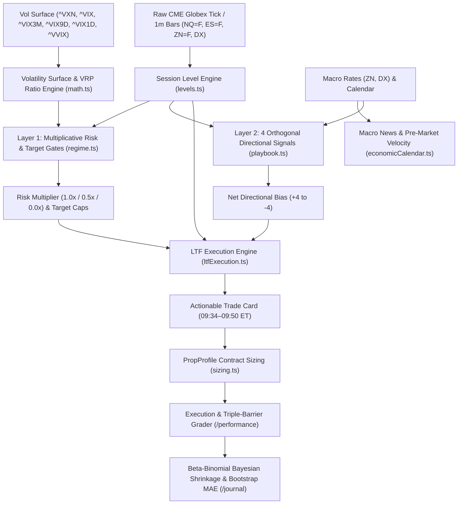

# MinBook v3.0 Quantitative & Algorithmic Architecture
## Mathematical Specifications, Two-Layer Gated Decision Engine, and Empirical Calibration

**Document Version:** 3.0.0  
**Target Instrument:** CME E-mini Nasdaq-100 Futures (`NQ`) & Micro E-mini (`MNQ`)  
**Strategy Focus:** 1 Trade Per Day • Higher-Timeframe Continuation & Opening Sweep Reversals • 09:34–09:50 AM ET Execution Window (09:30–09:33 ET Hands-Off Observation Lock)  
**Risk Budget:** $200–$300 (Scaled Dynamically by Layer 1 Volatility Gates & PropProfile) | **Reachability Targets:** TP1 [0.25, 0.45]x ATR_Open_15m, TP2 [0.50, 0.75]x ATR_Open_15m  

---

## 1. Executive Summary & Strategy Framework

MinBook is an institutional-grade quantitative decision engine engineered for traders executing exactly **one trade per day on the Nasdaq-100 (`NQ`/`MNQ`) futures contract**. The system isolates high-probability continuation and opening sweep setups executing exclusively during the **09:34 AM to 09:50 AM Eastern Time (ET) execution window**, following a strict **09:30–09:33 AM ET observation freeze**.

Rather than displaying lagging indicators or additive scorecards that conflate volatility with direction, MinBook v3.0 implements:
1. **Two-Layer Gated Decision Architecture:** Strict mathematical decoupling of Layer 1 Multiplicative Risk & Target Gates (VRP, term structure, dealer gamma) from Layer 2 Orthogonal Directional Signals.
2. **Synchronized CME Market Data & Settlement Clocks:** PDC anchored strictly to official 16:00 ET CME settlement; options basis ratio timestamp synchronization ($\Delta t \le 60$s); 23-hour CME ZN Treasury futures; and honest "Volume-Weighted Wick Rejection" labeling.
3. **Volatility & Diurnal Scaling:** Cboe 30-day volatility indices divided by $\sqrt{365}$; honest ~57.5% normal straddle coverage; diurnally matched `ATR_Open_15m` (median range of trailing 15 sessions' 09:30–09:45 ET bar); and dimensionless ratio VRP ($\text{IV}/\text{RV}_{5\text{m}}$).
4. **Lower-Timeframe (1m) Execution Engine (`ltfExecution.ts`):** 09:30–09:33 ET hands-off lock tracking 3m Opening Range (`ORH_3m`, `ORL_3m`); Retrace Continuation vs. Opening Sweep + MSS Reversal; Anti-Chase Guardrails ($> 0.35\times \text{ATR}_{\text{Open}\_15\text{m}}$); 1m structural stops; reachability-bounded TP1/TP2 with Brownian first-passage touch probabilities; and a 1m MSS exit kill-switch.
5. **Typed Prop Firm Profiles (`PropProfile`):** Tailored risk parameters for Topstep, Tradeify, Apex, TPT, and MFFU (EOD Trailing vs. Intraday Unrealized Drawdown), capping TP at 1.3R–1.8R under trailing peak drawdown, dynamic consistency rule caps, and exact RT commissions + 3-tick (0.75 pt) opening slippage.
6. **Empirical Verification & Calibration:** 1-minute path-dependent Triple-Barrier R-Expectancy Grader (09:34–09:48 limit fill, Barrier 1 SL, Barrier 2 TP1/TP2 scale-out, Barrier 3 10:00 AM vertical exit, strictly proper Brier and Log scoring); closed-form Beta-Binomial Bayesian Shrinkage ($\alpha_0=25, \beta_0=25, \gamma=0.99$, clip $[0.6, 1.5]$, $N \ge 60$ status tag gate); and non-parametric bootstrap upper 90% confidence bound for MAE stop calibration ($N \ge 150$ total trades AND $\ge 75$ winning trades).

---

## 2. Market Data Ingestion & Execution Integrity

### 2.1 Pre-Market Structural Mode vs. Live Execution Mode
* **CME 10–15m Latency Standard:** CME Group mandates a 10-to-15 minute exchange delay on all free, unauthenticated web feeds (`NQ=F`, `ES=F`). MinBook enforces absolute transparency:
  * When `exchangeDataDelayedBy > 0` during `09:30–10:00 ET`, the app renders a prominent banner:  
    `DELAYED FUTURES FEED (10–15m LAG) — USE PRE-OPEN PLAN + LIVE CHART`.
  * Dynamic unverified live-candle triggers are locked so the trader executes strictly off pre-calculated structural reference levels and their live broker platform.
* **Synchronized Options Basis Locking:**
  * When computing NDX/NQ or QQQ/NQ basis for option walls (GEX Call Wall, Put Wall, Gamma Flip), the timestamps of the underlying quote and options feed must match within $\Delta t \le 60$ seconds. If $\Delta t > 60$s, MinBook locks the basis to the prior synchronous 16:00 ET settlement close, preventing artificial 100+ point wall shifts.
* **Prior Day Close (PDC) Settlement Anchor:**
  * Prior Day Close is strictly anchored to the official 16:00 ET CME settlement close, never the 17:00 ET Globex last trade print.
* **Macro Rate Input:**
  * Uses 23-hour CME 10-Year Treasury Note futures (`ZN=F`) instead of `^TNX` (which is halted pre-market) to measure real-time bond price changes.
* **Microstructure Labeling Honesty:**
  * In the absence of native CME AggressorSide tick flags (FIX tag 5797), bar-derived $CLV \times Volume$ is strictly labeled as **"Volume-Weighted Wick Rejection"**, never "True Footprint" or "Passive Absorption".
  * Bar-derived `CVD DIV` markers are disabled unless authenticated aggressor side flags are present.

---

## 3. Session Segmentation & Reference Level Math

Let $\mathcal{B} = \{b_t\}_{t=1}^N$ represent the sequence of 1-minute and 15-minute OHLCV bars, where each bar $b_t = (O_t, H_t, L_t, C_t, V_t, T_t)$, with $T_t$ localized to Eastern Time (`America/New_York`).

### 3.1 Extended Globex Window
The Globex session spans from 18:00 ET ($T_{\text{open}}$) of the prior evening to 09:30 ET ($T_{\text{bell}}$) of the current morning:
$$\mathcal{B}_{\text{globex}} = \{b_t \mid T_t \in [18:00_{d-1}, 09:30_d)\}$$

* **Overnight High (ONH):** $ONH = \max_{b_t \in \mathcal{B}_{\text{globex}}} (H_t)$
* **Overnight Low (ONL):** $ONL = \min_{b_t \in \mathcal{B}_{\text{globex}}} (L_t)$
* **Overnight Midpoint ($ON_{mid}$):** $ON_{mid} = \frac{ONH + ONL}{2}$
* **Overnight Range ($OR$):** $OR = ONH - ONL$

### 3.2 Sub-Session Reference Windows
* **London Session ($03:00 \le \text{Hour}(T_t) < 09:00$ ET):**
  $$LonH = \max_{t \in \text{London}} (H_t), \quad LonL = \min_{t \in \text{London}} (L_t)$$
* **Asian Session ($18:00 \le \text{Hour}(T_t) \text{ or } \text{Hour}(T_t) < 03:00$ ET):**
  $$AsiaH = \max_{t \in \text{Asia}} (H_t), \quad AsiaL = \min_{t \in \text{Asia}} (L_t)$$

### 3.3 Multi-Anchor VWAP & TWAP Fallback
1. **Globex VWAP:** Anchored at 18:00 ET prior evening across $\mathcal{B}_{\text{globex}}$.
2. **Prior Day RTH VWAP:** Anchored from 09:30 to 16:00 ET of the prior session.
3. **Session VWAP:** Anchored at 09:30 ET of the active session.

For bars where volume $V_t > 0$:
$$TypicalPrice_t = \frac{H_t + L_t + C_t}{3}, \quad VWAP = \frac{\sum_{t} TypicalPrice_t \cdot V_t}{\sum_{t} V_t}$$

> **TWAP Fallback Protection:** If $V_t \le 0$ or volume is flat across the feed, the system automatically falls back to Time-Weighted Average Price ($TWAP = \frac{1}{M}\sum TypicalPrice_t$) and explicitly labels the level `TWAP FALLBACK`.

### 3.4 Higher-Timeframe Structural Weighting
* Prior Day High (`PDH`), Prior Day Low (`PDL`), and Prior Day Settlement Close (`PDC`) along with Prior Day Volume Profile (`VAH`, `POC`, `VAL`) carry institutional structural priority (weights 85–95).
* 5-day daily swing Fibonacci levels (38.2%, 50.0%, 61.8%) are demoted to secondary confluence confirmation (weight 65), preventing arbitrary mathematical lines from overruling concrete auction pivots.

### 3.5 Rule of 16 Implied Move & Straddle Bands
Cboe volatility indices ($VXN$, $VIX$) annualize 30 calendar days of variance. Dividing by $\sqrt{252}$ artificially inflates expected daily move by $\sqrt{365/252} \approx 1.203$ (+20.3% error). MinBook strictly divides calendar-day indices by $\sqrt{365}$:

$$ExpectedMove_{1SD} = \frac{PDC \times (VXN / 100)}{\sqrt{365}}$$
$$ExpectedMove_{Straddle} = ExpectedMove_{1SD} \times \sqrt{\frac{2}{\pi}} \approx 0.79788 \times ExpectedMove_{1SD}$$

* $UpperStraddle = PDC + ExpectedMove_{Straddle}$
* $LowerStraddle = PDC - ExpectedMove_{Straddle}$
* **Honest Straddle Coverage:** Labeled honestly as **~57.5% Normal Distribution Coverage** (never deceptively as 68%, which applies to full 1.0 SD).
* Where available, MinBook ingests `VOLQ` (Nasdaq-100 annualized 30-day index divided by $\sqrt{252}$ if trading-day based) and `VIX1D` for same-day options pricing.

---

## 4. Volatility Surface, Realized Range & Macro Regime Engine

### 4.1 Realized Volatility & Dimensionless Variance Risk Premium (VRP)
Rather than computing linear point differences ($VXN - \text{RealizedVol}_{YZ}$ on 23h futures), MinBook computes VRP as a dimensionless ratio using 5-minute intraday realized volatility:

$$VRP = \frac{IV_{30d}}{RV_{5m, 20d}}$$

* **Rich Volatility ($VRP > 1.15$):** Options implied volatility trades at a healthy premium over intraday realized swings. Calm, orderly mean-reverting retrace conditions.
* **Fair Volatility ($0.95 \le VRP \le 1.15$):** Options prices match realized variance.
* **Vol Dislocation / Dislocation Stress ($VRP < 0.95 \implies RV > IV$):** Realized intraday swings outstrip options pricing. High-priority **STOP-RUN / DISLOCATION WARNING**. Automatically triggers Layer 1 risk throttling to **0.5x**.

### 4.2 Diurnally Matched Open Range Volatility (`ATR_Open_15m`)
Pre-market 15m ATR (04:00–08:00 ET) averages 8–18 points during thin overnight liquidity, whereas the 09:30–09:45 ET opening bar routinely expands to 35–80 points. Using pre-market ATR causes target reachability models to set targets that are clipped instantly or stops that are suffocated by standard opening noise.

MinBook computes diurnally matched `ATR_Open_15m`:
$$ATR\_Open\_15m = \text{Median}\left( \text{Range}_{09:30–09:45, d-15}, \dots, \text{Range}_{09:30–09:45, d-1} \right)$$
All opening stop bounds, reachability targets, and Anti-Chase gates are anchored strictly to `ATR_Open_15m`.

### 4.3 Volatility Term Structure & Shock Triggers
* **Term Ratio ($TermRatio = VIX / VIX3M$):**
  * $> 1.00$: **BACKWARDATION (Stress Regime)** $\implies$ Layer 1 Risk Multiplier cut to 0.5x, Chop Risk = SEVERE.
  * $0.95–1.00$: **ELEVATED**.
  * $< 0.95$: **CONTANGO (Normal)**.
* **Short-Term Shock ($VIX9D / VIX$):** $> 1.15$ flags acute opening event volatility.
* **Vol-of-Vol ($VVIX$):** $\ge 110$ flags extreme tail-risk stop runs.

### 4.4 Macro Impulse via 23h CME ZN & DX Futures
Pre-market rate changes are measured from 23-hour CME 10-Year Treasury Note futures (`ZN=F`) and Dollar Index futures (`DX=F`), avoiding the pre-market freeze of cash `^TNX`.
* Rolling 60-day Pearson correlation $r(NQ, ZN)$ establishes the macro transmission regime (Inflation vs. Growth-Scare).

---

## 5. Two-Layer Gated Decision Engine

MinBook enforces a strict mathematical separation between non-directional risk state and directional bias.

### Layer 1: Multiplicative Risk & Target Gates (regime.ts)
Controls position size multiplier ($1.0x / 0.5x / 0.0x$), target caps, and volatility warnings. Layer 1 signals **NEVER** add or subtract points from the directional scorecard.
1. **Variance Risk Premium ($VRP$):** $VRP < 0.95 \implies 0.5x$ size multiplier.
2. **Term Structure Ratio ($VIX / VIX3M$):** $> 1.00 \implies 0.5x$ size multiplier.
3. **Vol-of-Vol ($VVIX$):** $\ge 110 \implies 0.5x$ size multiplier.
4. **Dealer Gamma Tilt (GEX):**
   * Positive Gamma ($+\Gamma$): Scales target caps down to 1.8R–2.2R (pinning/mean-reversion).
   * Negative Gamma ($-\Gamma$): Permits target expansion up to 2.5R–3.0R (volatility acceleration).
5. **Macro News Proximity:** Hard 0.0x lockout if high-impact release falls within $\pm 2$ minutes of open.

### Layer 2: 4 Orthogonal Directional Signals (playbook.ts)
Aggregates exactly four orthogonal directional inputs with equal 1.0 baseline weights (score $-4$ to $+4$):
1. **Composite HTF & Auction Location:** Combines HTF trend, PDC position, Session VWAP, and Overnight Inventory.
   * *Reversal-Risk Veto:* If Overnight Inventory $\ge 70\%$ (net long) but price opens below Overnight Midpoint, the system vetoes bullish votes and flags long inventory flush risk.
2. **Cross-Index SMT Divergence + Breadth:** Non-confirmations between `NQ` and `ES` swing extremes combined with mega-cap breadth.
3. **23h Macro Impulse:** Pre-market velocity and yield/dollar impulse via `ZN` and `DX`.
4. **Opening Flow:** Evaluates Volume-Weighted Wick Rejection (CLV body/wick distribution) at structural inflection levels.

* **Conviction Tiers:**
  * **HIGH CONVICTION:** Net Score $\ge +3$ or $\le -3$ with Layer 1 clearance.
  * **MODERATE CONVICTION:** Net Score $+1$ to $+2$ or $-1$ to $-2$.
  * **NEUTRAL / CAUTION:** Net Score $0$ (stand aside).

---

## 6. Lower-Timeframe (1m) Execution Engine (`ltfExecution.ts`)

Operating during the **09:34–09:50 AM ET execution window** following the 09:30–09:33 ET observation freeze, the LTF Execution Engine outputs a concrete, actionable Trade Card:

### 6.1 Setup Archetypes
1. **Retrace Continuation Card:**
   * Computes the 40%–50% impulse retrace zone into 1m Fair Value Gaps (FVG) or Session VWAP.
   * Places 1m structural stop:
     $$SL = \text{1m Swing Extreme} \pm \max(3.0 \text{ pts}, 0.25 \times ATR_{1m})$$
   * Triggers an **ANTI-CHASE WARNING** if live price is $> 0.35 \times ATR\_Open\_15m$ from the invalidation stop.
2. **Sweep + MSS Reversal Card:**
   * Detects liquidity sweeps of `ORH_3m` / `ORL_3m` or `ONH` / `ONL` followed by a 1-minute displacement candle closing back inside range (Market Structure Shift).
   * Anchors stop loss strictly to the sweep wick extreme.

### 6.2 Reachability Target Engine
* Uses Brownian first-passage touch probability over 5m, 10m, and 15m horizons with $\sigma_{15m} = 0.50 \times ATR\_Open\_15m$:
  $$P(\text{Touch Target } L \text{ within time } T) = 2 \left( 1 - \Phi\left( \frac{|L - P_{\text{entry}}|}{\sigma \sqrt{T / 15}} \right) \right)$$
* **TP1:** Selected strictly from structural pivots inside $[0.25, 0.45] \times ATR\_Open\_15m$ (e.g., `ORH_3m`/`ORL_3m`, micro-VWAP).
* **TP2:** Selected strictly inside $[0.50, 0.75] \times ATR\_Open\_15m$ (next liquidity pool).
* **HTF Context Demotion:** Any HTF levels (PDH, PDL, Straddle, GEX walls) lying $> 0.75 \times ATR\_Open\_15m$ away are demoted to a collapsed `HTF Context Only` panel with their 10m touch probability badge, preventing them from masquerading as scalp targets.

### 6.3 1m MSS Exit / Kill-Switch Price
* If an active trade reaches $\ge 0.8R$ MFE (e.g. tags TP1) and an opposing 1-minute candle subsequently closes back across the entry price, the system triggers an immediate **MSS Kill-Switch Exit** to protect locked partial profits.

---

## 7. Typed Prop Firm Profiles (`PropProfile`) & Dynamic Sizing

MinBook incorporates typed configurations for leading prop firm evaluation models:

| Profile Name | Drawdown Mode | Daily Target | Loss Limit | Consistency Cap | Fees (RT MNQ) | Slippage (pts) | Max MNQ |
| :--- | :--- | :--- | :--- | :--- | :--- | :--- | :--- |
| **Topstep_EOD** | EOD_SETTLEMENT | $600 | $400 | 40% ($240 max/day) | $1.30 | 0.75 (3 ticks) | 5 |
| **Tradeify_EOD** | EOD_SETTLEMENT | $600 | $400 | 40% ($240 max/day) | $1.24 | 0.75 (3 ticks) | 5 |
| **Apex_EOD** | EOD_SETTLEMENT | $600 | $400 | 35% ($210 max/day) | $1.20 | 0.75 (3 ticks) | 5 |
| **Apex_Intraday** | INTRADAY_UNREALIZED | $500 | $350 | 30% ($150 max/day) | $1.20 | 0.75 (3 ticks) | 4 |
| **TPT_PRO_Intraday**| INTRADAY_UNREALIZED | $500 | $350 | 30% ($150 max/day) | $1.26 | 0.75 (3 ticks) | 4 |
| **MFFU_Rapid_Intraday**| INTRADAY_UNREALIZED| $500 | $350 | 35% ($175 max/day) | $1.30 | 0.75 (3 ticks) | 4 |
| **MFFU_Pro_EOD** | EOD_SETTLEMENT | $600 | $400 | 40% ($240 max/day) | $1.30 | 0.75 (3 ticks) | 5 |

* **Intraday Unrealized Drawdown Guardrail:** If `drawdownMode === 'INTRADAY_UNREALIZED'`, TP is automatically capped at 1.3R–1.8R, breakeven runners are disabled, and a prominent phantom-drawdown alert is displayed.
* **Consistency Rule Profit Caps:** Daily profit targets are dynamically capped below the rule threshold (e.g., $0.38 \times \text{Target}$ on 40% rules).
* **Quantization & Contract Splitting:**
  * If calculated size is 1 MNQ, partial scale-outs are disabled; the engine switches to a single TP1 exit.
  * If calculated size is $\ge 2$ MNQ, the engine allocates scale-outs (50% at TP1, 50% runner at TP2).

---

## 8. Empirical Verification, Triple-Barrier Auto-Grading & Safe Calibration

### 8.1 1-Minute Path-Dependent Triple-Barrier R-Expectancy Grader
Replaces binary open-to-high ATR expansion graders with realistic execution path simulation:
1. **Limit Entry Simulation:** Simulates limit entry at the predicted 40%–50% retrace zone between 09:34 and 09:48 ET. If price never retraces, outcome is recorded honestly as `NO_FILL`.
2. **Barrier 1 (Stop Loss):** Invalidation stop hit $\implies$ logs realized $-1.0R$ net of friction.
3. **Barrier 2 (Take Profit):** Scale-out 1 contract at TP1; exit remaining runner at TP2 or via 1m MSS kill-switch.
4. **Barrier 3 (Time Exit):** At 10:00 AM ET, any remaining active contracts are liquidated at the 10:00 AM close price.
5. **Friction Accounting:** Deducts exact round-trip commissions ($1.30 MNQ) plus 3-tick (0.75 pt / $1.50) opening slippage.
6. **Strictly Proper Scoring Rules:** Evaluates Brier score $(p - y)^2$ and Logarithmic scoring rule $-\sum y \ln(p)$.

### 8.2 Closed-Form Beta-Binomial Bayesian Shrinkage Optimizer
Replaces chronological walk-forward batch optimization with closed-form Bayesian shrinkage:
* Conjugate Beta prior: $\alpha_0 = 25, \beta_0 = 25$ (prior mean 50%, prior pseudo-sample size 50).
* Optional exponential forgetting factor: $\gamma = 0.99$.
* Posterior mean:
  $$\hat{\theta}_j^{\text{Bayes}} = \frac{k_j^{(\gamma)} + \alpha_0}{n_j^{(\gamma)} + \alpha_0 + \beta_0}$$
* Production weight clipping:
  $$w_j^* = \max\left( 0.6, \min\left( 1.5, 2.0 \times \hat{\theta}_j^{\text{Bayes}} \right) \right)$$
* **Strict Sample Size Gate ($N \ge 60$):** `EDGE ENHANCER` ($\ge +4\%$) and `NOISE DETRACTOR` ($\le -4\%$) tags remain suppressed (`NEUTRAL`) until effective sample size $N \ge 60$.

### 8.3 Non-Parametric Bootstrap MAE Stop Calibration
* **Dual Collection Gate ($N \ge 150$ total trades AND $\ge 75$ winning trades):** Prevents premature stop tightening based on small-sample curve fitting.
* When calibrated, computes the **upper 90% bootstrap confidence bound** of Winners' P90 MAE across 1,000 resamples:
  $$\text{Upper } 90\% \text{ Bootstrap Bound} = \text{Quantile}_{0.90}\left( \{ \text{P90 MAE}^{*(b)} \}_{b=1}^{1000} \right)$$
* Stop tightening is recommended only if the upper bootstrap bound demonstrates that 90% of resampled distributions experience adverse excursion within safe limits.
