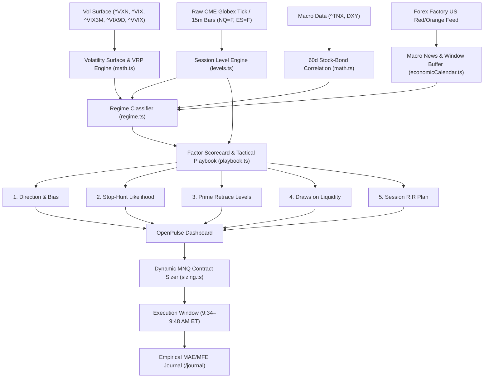

# OpenPulse Quantitative & Algorithmic Architecture (v2.0)
## Mathematical Specifications, Volatility Surface Models, and Decision Engine Logic

**Document Version:** 2.0.0  
**Target Instrument:** CME E-mini Nasdaq-100 Futures (`NQ`) & Micro E-mini (`MNQ`)  
**Strategy Focus:** 1 Trade Per Day • Higher-Timeframe Continuation • 9:30–10:00 AM ET Retrace Window  
**Risk Budget:** \$200–\$300 (Scaled by Volatility & Contract Size) | **Target:** \$500–\$600 (~2.0R–3.0R)  

---

## 1. Executive Summary & Strategy Framework

OpenPulse v2.0 is an institutional-grade quantitative briefing and decision system engineered for traders executing exactly **one trade per day on the Nasdaq-100 (`NQ`/`MNQ`) futures contract**. The system isolates high-probability higher-timeframe (HTF) continuation opportunities entering exclusively on a retracement during the **9:30 AM to 10:00 AM Eastern Time (ET) New York cash open window**.

Rather than displaying lagging indicators on top of charting platforms, OpenPulse synthesizes:
1. Multi-session reference structures (Globex `[18:00, 09:30)` ET, London `[03:00, 09:00)` ET, Asia, Prior Day).
2. Institutional fair-value benchmarks (Separate Globex VWAP, Prior Day RTH VWAP, and Session VWAP with TWAP fallback).
3. Standardized Overnight Inventory Order-Flow Imbalances (0%–100% above PDC).
4. Full Options Volatility Surface (`^VXN`, `^VIX`, `^VIX3M`, `^VIX9D`, `^VIX1D`, `^VVIX`).
5. Realized Volatility Estimators (Yang-Zhang & Garman-Klass) and Variance Risk Premium ($VRP = IV - RV$).
6. Rule of 16 Implied Move & Straddle Bands.
7. Cross-Index SMT Divergence (`NQ=F` vs. `ES=F`).
8. Macro correlation regime (Rolling 60-day Pearson correlation of `NQ` vs. `10Y Yield`).
9. Dynamic Volatility-Normalized Risk & MNQ Contract Sizing.
10. Post-trade empirical Maximum Adverse Excursion (MAE), Maximum Favorable Excursion (MFE), and Exit Efficiency distributions.

---

## 2. Market Data Ingestion & Execution Integrity

### 2.1 Pre-Market Structural Mode vs. Live Execution Mode
* **CME 10–15m Latency Standard:** CME Group mandates a 10-to-15 minute exchange delay on all free, unauthenticated web feeds (`NQ=F`, `ES=F`). OpenPulse v2.0 enforces absolute transparency:
  * When `exchangeDataDelayedBy > 0` during `09:30–10:00 ET`, the app renders a prominent banner:  
    `DELAYED FUTURES FEED (10–15m LAG) — USE PRE-OPEN PLAN + LIVE CHART`.
  * Dynamic unverified live-candle triggers are locked so the trader executes strictly off pre-calculated structural reference levels and their live broker platform.
* **Live Equity Proxy (`QQQ`) Integration:**
  * Ingests real-time `QQQ` during regular trading hours as an un-delayed directional guide and opening-drive confirmation proxy.

---

## 3. Session Segmentation & Reference Level Math

Let $\mathcal{B} = \{b_t\}_{t=1}^N$ represent the sequence of 15-minute OHLCV bars, where each bar $b_t = (O_t, H_t, L_t, C_t, V_t, T_t)$, with $T_t$ localized to Eastern Time (`America/New_York`).

### 3.1 Extended Globex Window
The Globex session spans from 18:00 ET ($T_{\text{open}}$) of the prior evening to 09:30 ET ($T_{\text{bell}}$) of the current morning, preserving the critical 09:15–09:30 ET pre-open liquidity sweeps:
$$\mathcal{B}_{\text{globex}} = \{b_t \mid T_t \in [18:00_{d-1}, 09:30_d)\}$$

* **Overnight High (ONH):** $ONH = \max_{b_t \in \mathcal{B}_{\text{globex}}} (H_t)$
* **Overnight Low (ONL):** $ONL = \min_{b_t \in \mathcal{B}_{\text{globex}}} (L_t)$
* **Overnight Midpoint ($ON_{mid}$):** $ON_{mid} = \frac{ONH + ONL}{2}$
* **Overnight Range ($OR$):** $OR = ONH - ONL$

### 3.2 Sub-Session Reference Windows
* **London Session ($03:00 \le \text{Hour}(T_t) < 09:00$ ET):**
  $$LonH = \max_{t \in \text{London}} (H_t), \quad LonL = \min_{t \in \text{London}} (L_t)$$
* **Asian Session ($18:00 \le \text{Hour}(T_t) \text{ or } \text{Hour}(T_t) < 03:00$ ET):**
  $$AsiaH = \max_{t \in \text{Asia}} (H_t), \quad AsiaL = \min_{t \in \text{Asia}} (L_t)$$

### 3.3 Multi-Anchor VWAP & TWAP Fallback
VWAP benchmarks institutional volume-weighted fair value. OpenPulse v2.0 segments VWAP anchors cleanly:
1. **Globex VWAP:** Anchored at 18:00 ET prior evening across $\mathcal{B}_{\text{globex}}$.
2. **Prior Day RTH VWAP:** Anchored from 09:30 to 16:00 ET of the prior session.
3. **Session VWAP:** Anchored at 09:30 ET of the active session.

For bars where volume $V_t > 0$:
$$TypicalPrice_t = \frac{H_t + L_t + C_t}{3}$$
$$VWAP = \frac{\sum_{t} TypicalPrice_t \cdot V_t}{\sum_{t} V_t}$$

> **TWAP Fallback Protection:** If $V_t \le 0$ or volume is flat across the feed, the system automatically falls back to Time-Weighted Average Price ($TWAP = \frac{1}{M}\sum TypicalPrice_t$) and explicitly labels the level `TWAP FALLBACK`.

### 3.4 Higher-Timeframe (HTF) Fibonacci Retracement & Impulse Direction
OpenPulse v2.0 determines impulse direction by comparing the timestamps of the 5-day swing extremes:
$$T_{low} = \text{Timestamp}(\min(\mathcal{D}_{lows})), \quad T_{high} = \text{Timestamp}(\max(\mathcal{D}_{highs}))$$
$$Range = HTF_{high} - HTF_{low}$$

* **Case 1: Bullish Impulse ($T_{low} < T_{high}$):**
  Price rallied from low to high; retracement pulls down into discount:
  * Shallow: $Fib_{38.2} = HTF_{high} - 0.382 \times Range$
  * Equilibrium: $Fib_{50.0} = HTF_{high} - 0.500 \times Range$
  * Golden Pocket: $Fib_{61.8} = HTF_{high} - 0.618 \times Range$
  * Optimal Trade Entry (OTE): $Fib_{70.5} = HTF_{high} - 0.705 \times Range$
* **Case 2: Bearish Impulse ($T_{high} < T_{low}$):**
  Price dropped from high to low; retracement bounces up into premium:
  * Shallow: $Fib_{38.2} = HTF_{low} + 0.382 \times Range$
  * Equilibrium: $Fib_{50.0} = HTF_{low} + 0.500 \times Range$
  * Golden Pocket: $Fib_{61.8} = HTF_{low} + 0.618 \times Range$
  * Optimal Trade Entry (OTE): $Fib_{70.5} = HTF_{low} + 0.705 \times Range$

### 3.5 Rule of 16 Implied Move & Straddle Bands
Using Cboe Nasdaq-100 Volatility Index ($VXN$, fallback $VIX$):
$$ExpectedMove_{1SD} = \frac{PDC \times (VXN / 100)}{\sqrt{252}}$$
$$ExpectedMove_{Straddle} = ExpectedMove_{1SD} \times \sqrt{\frac{2}{\pi}} \approx 0.79788 \times ExpectedMove_{1SD}$$

* $UpperStraddle = PDC + ExpectedMove_{Straddle}$
* $LowerStraddle = PDC - ExpectedMove_{Straddle}$
* **Overnight Range Consumed %:**
  $$\% \text{ Consumed} = \frac{OR}{2 \times ExpectedMove_{Straddle}} \times 100$$
  When $\% \text{ Consumed} < 30\%$, the session is classified as compressed with elevated opening chop risk.

### 3.6 Cross-Index SMT Divergence (`NQ=F` vs. `ES=F`)
Cross-index Smart Money Tool (SMT) divergence detects non-confirmations between tech (`NQ`) and broad market (`ES`):
* **Bullish SMT:** `NQ` sweeps its session low ($P_{NQ} < ONL_{NQ}$) while `ES` holds higher ($P_{ES} \ge ONL_{ES}$), or vice versa. Indicates institutional absorption.
* **Bearish SMT:** `NQ` sweeps its session high ($P_{NQ} > ONH_{NQ}$) while `ES` fails to make a new high ($P_{ES} \le ONH_{ES}$). Warns of smart money distribution.

---

## 4. Volatility Surface, Realized Range & Macro Regime Engine

### 4.1 Realized Volatility Estimators
1. **Garman-Klass Realized Volatility ($\sigma_{GK}$):**
   $$\sigma_{GK}^2 = \frac{1}{N} \sum_{i=1}^N \left[ 0.5 \left( \ln \frac{H_i}{L_i} \right)^2 - (2\ln 2 - 1) \left( \ln \frac{C_i}{O_i} \right)^2 \right]$$
   $$\text{Annualized } \sigma_{GK} = \sqrt{252 \times \sigma_{GK}^2} \times 100\%$$
2. **Yang-Zhang Realized Volatility ($\sigma_{YZ}$):**
   Handles overnight price jumps, open-to-close drift, and continuous intraday variance with minimum variance weighting:
   $$k = \frac{0.34}{1.34 + \frac{N+1}{N-1}}$$
   $$\sigma_{YZ}^2 = \sigma_o^2 + k \sigma_c^2 + (1-k) \sigma_{RS}^2$$
   $$\text{Annualized } \sigma_{YZ} = \sqrt{252 \times \max(0, \sigma_{YZ}^2)} \times 100\%$$

### 4.2 Variance Risk Premium (VRP) & Dislocation Trigger
$$VRP = VXN - \text{RealizedVol}_{YZ, 20d}$$
* **Normal Regime ($VRP > 0$):** Implied volatility carries a premium over realized volatility.
* **Negative VRP ($VRP < 0 \implies RV > IV$):** High-priority **STOP-RUN / DISLOCATION WARNING**. Realized volatility exceeds options pricing. Triggers automatic risk scaling to **0.5x**.

### 4.3 Volatility Term Structure & Shock Triggers
* **Term Ratio ($TermRatio = VIX / VIX3M$):**
  * $> 1.00$: **BACKWARDATION (Stress Regime)** $\implies$ Risk cut to 0.5x, Chop Risk = SEVERE.
  * $0.95–1.00$: **ELEVATED**.
  * $< 0.95$: **CONTANGO (Normal)**.
* **Short-Term Shock ($VIX9D / VIX$):** $> 1.15$ flags acute opening event volatility.
* **Vol-of-Vol ($VVIX$):** $\ge 110$ flags extreme tail-risk stop runs.

### 4.4 Macro Stock-Bond Correlation Engine
Computes rolling 60-day Pearson correlation $r(NQ, TNX)$ between daily percentage returns of NQ and 10Y Treasury Yield:
$$r = \frac{\sum (R_{NQ} - \bar{R}_{NQ})(R_{TNX} - \bar{R}_{TNX})}{\sqrt{\sum (R_{NQ} - \bar{R}_{NQ})^2 \sum (R_{TNX} - \bar{R}_{TNX})^2}}$$

* **Inflation / Rate-Sensitive Regime ($r < -0.20$):** Rising yields ($TNX \uparrow$) act as equity headwinds.
* **Growth-Scare Regime ($r > +0.20$):** Falling yields accompany equity selling.
* Pre-market $TNX$ bps changes and $DXY$ % change directly factor into the factor scorecard.

### 4.5 Standardized Overnight Inventory ($OI$)
Stored and displayed strictly as **percentage of Globex bars closing above PDC** ($0\%–100\%$):
* $\ge 70\%$: **Net Long Imbalance** (trapped longs flush risk if 9:30 open stalls).
* $\le 30\%$: **Net Short Imbalance** (short squeeze acceleration risk).
* $30\%–70\%$: **Balanced**.

---

## 5. Volatility-Normalized Decision Engine & Factor Scorecard

### 5.1 Elimination of Fixed Point Cutoffs
All hardcoded thresholds have been replaced with dynamic multiples of $ATR_{15m}$ and $ExpectedMove_{Straddle}$:

| Condition | Dynamic Formulation |
| :--- | :--- |
| **Chop Pinch** | $|P - VWAP| < 0.35 \times ATR_{15m} \land |P - PDC| < 0.45 \times ATR_{15m}$ |
| **Stop-Hunt Proximity** | $|P - ONH| \le \min(2.0 \times ATR_{15m}, 0.25 \times ExpectedMove_{Straddle})$ |
| **Runaway Open Drive** | $|P - VWAP| > 1.75 \times ATR_{15m}$ beyond ONH |
| **Overnight Compression** | $OR / (2 \times ExpectedMove_{Straddle}) < 0.30$ |

### 5.2 The 7-Factor Scorecard
Eliminates fabricated probabilities in favor of an inspectable scorecard ($+1 / 0 / -1$):
1. **HTF Trend Alignment:** $+1$ (Bullish) / $-1$ (Bearish) / $0$ (Neutral).
2. **Prior Day Close (PDC):** $+1$ ($P > PDC$) / $-1$ ($P < PDC$).
3. **Session VWAP:** $+1$ ($P > VWAP$) / $-1$ ($P < VWAP$).
4. **Overnight Inventory:** $+1$ ($\ge 70\%$) / $-1$ ($\le 30\%$) / $0$ (Balanced).
5. **Cross-Index SMT:** $+1$ (Bullish SMT) / $-1$ (Bearish SMT) / $0$ (Synced).
6. **Volatility Surface & VRP:** $+1$ (Contango + Positive VRP) / $-1$ (Backwardation or Negative VRP).
7. **Macro Yields & Dollar:** $+1$ (Tailwind) / $-1$ (Headwind).

* **Likelihood Tiers:**
  * **HIGH:** Net Score $\ge +3$ or $\le -3$ with structural alignment.
  * **MODERATE:** Net Score $+1$ to $+2$ or $-1$ to $-2$.
  * **LOW:** Net Score $\approx 0$ (conflicting factors).

### 5.3 Execution Window Time-Decay Gate
* `09:30–09:33 ET`: **OPEN NOISE / SWEEP WATCH** (hands off mouse).
* `09:34–09:48 ET`: **PRIME RETRACE WINDOW** (high-probability execution).
* `09:49–09:59 ET`: **LATE WINDOW / DECAY CAUTION** (de-risk runners before 10:00 AM macro prints).
* Automated **NEWS BUFFER WARNING** for 09:45 AM (PMI) or 10:00 AM (ISM) releases.

---

## 6. Dynamic Volatility-Normalized Risk & MNQ Contract Sizing

OpenPulse v2.0 replaces fixed-point assumptions with dynamic contract scaling:

$$\text{Adjusted Risk Dollars} = \text{Base Risk Budget} \times \text{Regime Risk Multiplier}$$

$$\text{Recommended MNQ Contracts} = \left\lfloor \frac{\text{Adjusted Risk Dollars}}{\text{Stop Distance Pts} \times 2} \right\rfloor$$

$$\text{Drawdown Risk \%} = \frac{\text{Actual Dollar Risk}}{\text{Real Prop Drawdown}} \times 100$$

* **Regime Risk Multiplier:**
  * $1.0x$: Normal Contango regime with positive VRP.
  * $0.5x$: Backwardation, Negative VRP, $VVIX \ge 110$, or elevated short-term shock.
  * $0.0x$: Stand aside on severe macro news conflicts.
* **Stop-Too-Tight Warning:** Triggered if $\text{Stop Distance Pts} < 0.5 \times ATR_{15m}$.
* **Drawdown Risk Warning:** Triggered if $\text{Drawdown Risk \%} > 12.5\%$ of real prop drawdown.

---

## 7. Directional MAE / MFE Analytics & Empirical Calibration

### 7.1 Directional Excursion Formulas
* **LONG Trades:**
  $$MAE_R = \max\left(0, \frac{P_{entry} - P_{worstLow}}{\text{Risk Pts}}\right), \quad MFE_R = \max\left(0, \frac{P_{bestHigh} - P_{entry}}{\text{Risk Pts}}\right)$$
* **SHORT Trades:**
  $$MAE_R = \max\left(0, \frac{P_{worstHigh} - P_{entry}}{\text{Risk Pts}}\right), \quad MFE_R = \max\left(0, \frac{P_{entry} - P_{bestLow}}{\text{Risk Pts}}\right)$$
* **MFE Exit Efficiency (Winning Trades):**
  $$\text{Exit Efficiency \%} = \frac{\text{Actual PnL (R)}}{MFE_R} \times 100 \quad (\text{Benchmark: } 65\%–80\%)$$

### 7.2 50-Trade Sample Calibration Gate
To eliminate fabricated static statistics and prevent curve-fitting:
* **Collection Phase ($N < 50$):** UI displays:  
  `COLLECTING SAMPLE (X / 50 TRADES) — DO NOT TIGHTEN STOPS YET`.
* **Calibrated Phase ($N \ge 50$):** Dynamically computes the **85th and 90th percentiles of Winners' MAE** strictly from the local SQLite database.
* **Daily Regime Snapshots:** Each trade automatically stores $VXN$, $VIX/VIX3M$, $VVIX$, $VRP$, $OI$, $SMT$, and Bias Verdict at entry for regime-filtered expectancy analysis.
